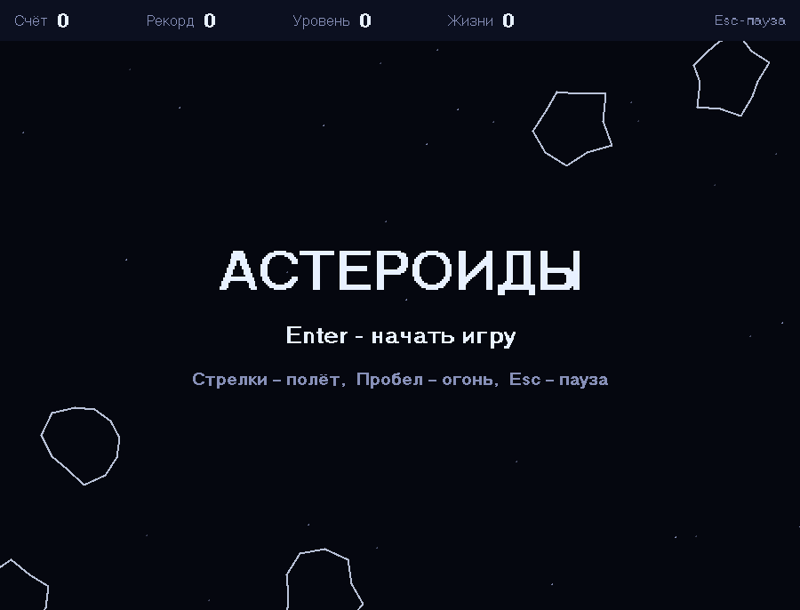
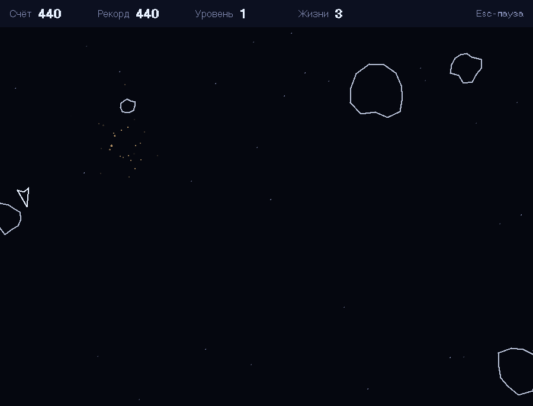
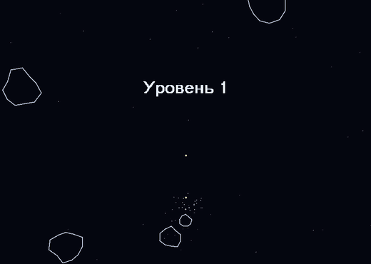

# Астероиды

**Автор:** Харламова Елизавета Романовна

**Группа:** ПИ25-1

**Дисциплина:** —

**Дата сдачи:** —

## Описание проекта

Упрощённая версия классической аркады «Asteroids». Игрок управляет маленьким космическим
кораблём среди летящих астероидов: поворачивает его, разгоняется и стреляет. Большой астероид
от попадания раскалывается на два средних, средний — на два маленьких, маленький рассыпается.
Корабль летит по инерции, края экрана «склеены». Когда все астероиды сбиты, начинается
следующий уровень, где камней больше. Столкновение с астероидом стоит жизни, жизней три.

Работа выполнена по заданию «Простые астероиды» из лабораторной работы №3 «Простые игры».

## Функциональные возможности

### Основной функционал

- 🚀 Корабль: поворот, двигатель с инерцией и плавным торможением, стрельба
- ☄️ Астероиды трёх размеров неровной формы, медленно вращаются и раскалываются от попадания
- 🔁 «Склеенные» края поля: улетевшее за край появляется с другой стороны
- 💥 Столкновения, взрывы с разлетающимися обломками
- ❤️ Три жизни, временная защита (мигание) после появления нового корабля
- 🏆 Очки (20 / 50 / 100 за большой / средний / маленький астероид), рекорд, уровни

### Дополнительный функционал

- 🔥 Анимированное пламя двигателя
- 🌌 Звёздное небо и заставка с летящими астероидами
- ⏸️ Пауза
- 📊 Строка состояния: счёт, рекорд, уровень и жизни
- ✅ Модульные тесты физики и правил игры

## Демонстрация работы программы

### Заставка



### Игра



### Анимация



## Требования к системе

- **Python:** 3.9 или выше
- **Операционная система:** Windows / macOS / Linux
- **Библиотеки:** только стандартная библиотека Python
  - `tkinter` (встроенная) — окно, холст, надписи
  - `math`, `random`, `dataclasses`, `time` — физика, случайность и служебные функции
  - `unittest` — тесты

## Установка и запуск

### 1. Клонирование репозитория

```bash
git clone https://github.com/lizabasya408-dota/asteroids.git
cd asteroids
```

### 2. Создание и активация виртуального окружения

Windows:

```bash
python -m venv venv
venv\Scripts\activate
```

macOS/Linux:

```bash
python3 -m venv venv
source venv/bin/activate
```

### 3. Установка зависимостей

```bash
pip install -r requirements.txt
```

Сторонних библиотек нет, команда оставлена для единообразия.

### 4. Запуск программы

```bash
python main.py
```

### 5. Управление

| Действие | Клавиша |
|---|---|
| Начать игру / сыграть ещё раз | `Enter` |
| Повернуть корабль | `←` `→` |
| Двигатель (разгон) | `↑` |
| Стрелять (можно держать) | `Пробел` |
| Пауза / продолжить | `Esc` |

### 6. Запуск тестов

```bash
python -m unittest discover -s tests -t . -v
```

## Структура проекта

```text
asteroids/
├── .gitignore
├── README.md
├── requirements.txt
├── main.py                      # запуск программы
├── venv/                        # виртуальное окружение
├── screenshots/                 # картинки для README
├── src/
│   ├── __init__.py
│   ├── app.py                   # AsteroidsApp: окно, клавиатура, игровой цикл
│   ├── config.py                # размеры, физика, очки, цвета
│   ├── models/
│   │   ├── __init__.py
│   │   ├── space_object.py      # SpaceObject: движение, склеенные края, столкновения
│   │   ├── ship.py              # Ship: поворот, двигатель, инерция
│   │   ├── asteroid.py          # Asteroid: форма, вращение, раскалывание
│   │   ├── bullet.py            # Bullet и Debris: пули и обломки с временем жизни
│   │   └── game.py              # AsteroidsGame: уровни, стрельба, очки, жизни
│   ├── renderers/
│   │   ├── __init__.py
│   │   └── space_renderer.py    # SpaceRenderer: звёзды, корабль, астероиды, надписи
│   └── widgets/
│       ├── __init__.py
│       └── status_bar.py        # StatusBar: счёт, рекорд, уровень, жизни
└── tests/
    ├── __init__.py
    └── test_asteroids.py        # тесты физики и правил игры
```

**Почему так.** Код написан в объектно-ориентированном стиле и разделён на независимые части:

- `models/` — только физика и правила, без tkinter, поэтому их удобно проверять тестами.
  Корабль, астероид, пуля и обломок наследуются от общего класса `SpaceObject`,
  в котором один раз написаны движение, склеенные края и проверка столкновений;
- `renderers/` — только рисование;
- `widgets/` — строка состояния над полем;
- `app.py` соединяет части и управляет главным циклом.

## Как работает алгоритм

Каждый кадр (примерно 60 раз в секунду, через `root.after()`) игра делает шаг времени `dt`:

1. **Движение.** Положение меняется на скорость × время: `x = x + vx · dt`. Чтобы края были
   «склеены», берётся остаток от деления на размер поля: `x = x % ширина`.
2. **Корабль.** Направление носа по углу `a`: `(sin a, −cos a)` (минус — ось Y экрана
   смотрит вниз). Двигатель прибавляет к скорости ускорение в сторону носа, скорость
   ограничена сверху. Без двигателя скорость плавно гаснет: `v = v · e^(−k·dt)`.
3. **Пули.** Вылетают из носа со своей скоростью плюс скоростью корабля, живут 0,9 секунды.
   Между выстрелами есть пауза перезарядки.
4. **Столкновения.** Все объекты считаются кругами: два круга пересекаются, если расстояние
   между центрами меньше суммы радиусов.
5. **Раскалывание.** Сбитый астероид заменяется двумя на размер меньше. Осколки получают
   случайную скорость своего размера плюс половину скорости родителя.
6. **Уровни и жизни.** Когда астероидов не осталось, появляются новые, на один больше.
   После столкновения корабль взрывается, через 1,5 секунды появляется новый в центре
   с защитой на 2,5 секунды; когда жизни кончились — конец игры.

**Форма астероида.** Вершины многоугольника стоят по кругу через равные углы, но каждая —
на своём случайном расстоянии от центра (от 0,7 до 1,15 радиуса), поэтому все камни разные.

## Пример использования

```bash
python main.py
```

- Нажмите `Enter`, чтобы начать.
- Держите `Пробел` и поворачивайте корабль стрелками — пушка стреляет очередью.
- Не разгоняйтесь слишком сильно: корабль летит по инерции и тормозит медленно.
- Нажмите `Esc`, чтобы поставить игру на паузу.
